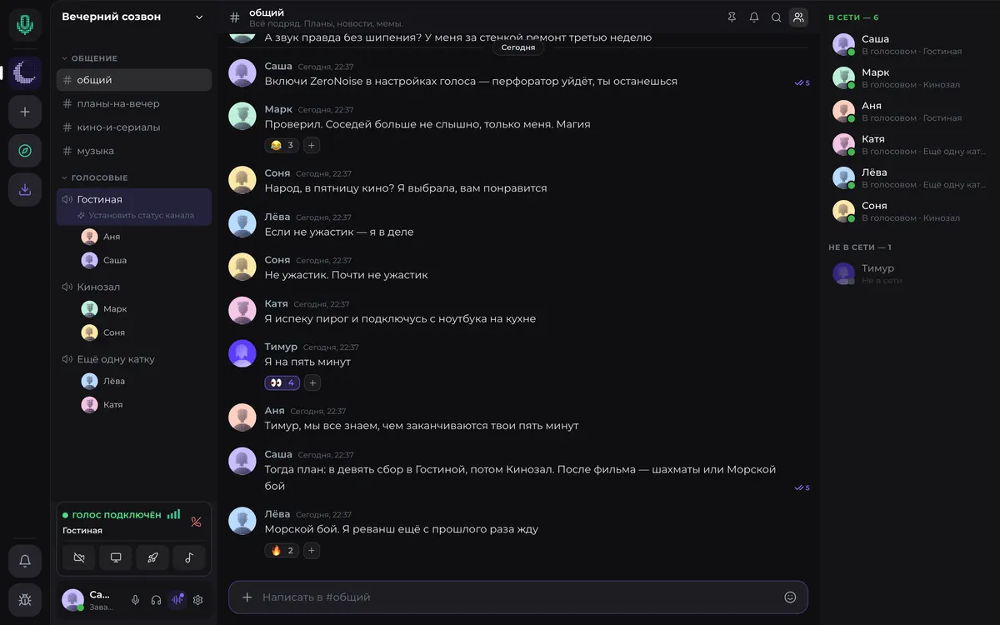
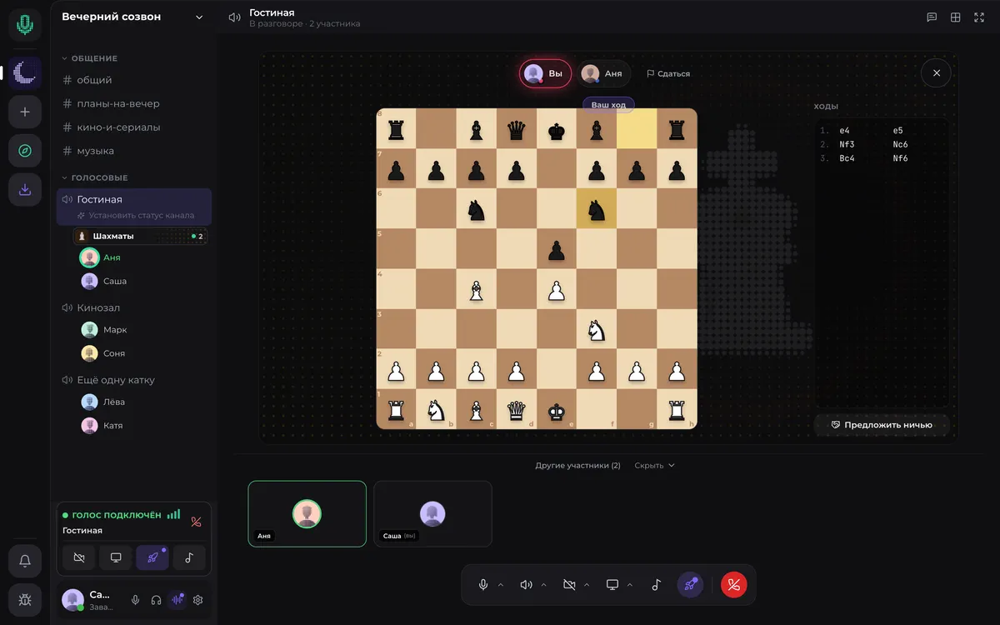
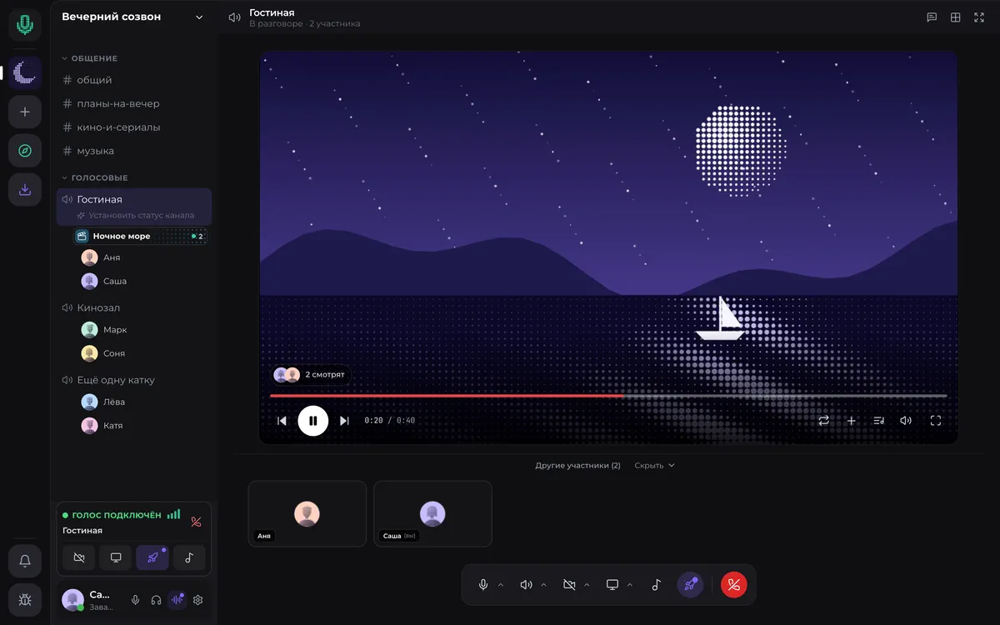

  

<h1 align="center">Voice — ближе, даже издалека</h1>

  Своя компания. Свои разговоры. Свой Voice. 
  Голосовой чат для друзей и сообществ — в браузере, на компьютере и телефоне.

  <a href="https://voice-chat.ru"><strong>voice-chat.ru</strong></a> ·
  <a href="https://voice-chat.ru/@me"><strong>Открыть в браузере</strong></a> ·
  <a href="https://voice-chat.ru/download"><strong>Скачать Voice</strong></a>

  
  
  

---

## Место, куда хочется вернуться

Зайти после учёбы. Собрать команду на вечер. Обсудить день, показать экран или остаться в голосовом, пока каждый занимается своим. В Voice у вашей компании есть своё место.

**Основные возможности доступны бесплатно.** Начните в браузере, а приложение установите, когда понадобятся оверлей, глобальные горячие клавиши и удобный доступ с рабочего стола.

Интерфейс Voice с демонстрационными данными.

## Больше поводов быть вместе

- **Разговаривайте.** Голосовые каналы, личные звонки, видео и шумоподавление — чтобы слышать друг друга.
- **Собирайте сообщество.** Свои серверы, текстовые каналы, роли, права доступа и приглашения для друзей.
- **Показывайте.** Демонстрация экрана для совместной работы, игр и разговоров по ходу дела.
- **Играйте и смотрите.** Шахматы, Морской бой, Крокодил и совместный просмотр прямо в голосовом канале.
- **Слушайте музыку.** Делитесь настроением и находите саундтрек для общего вечера.
- **Выражайте себя.** Настраивайте профиль, создавайте оформления в студии и открывайте работы авторов в маркете.

  
  

Игры и совместный просмотр · интерфейс с демонстрационными данными.

[Посмотреть все возможности →](https://voice-chat.ru/features)

## Начните с первого «привет»

1. [Откройте Voice в браузере](https://voice-chat.ru/@me) и создайте аккаунт.
2. Создайте свой сервер или присоединитесь к друзьям по приглашению.
3. Зайдите в голосовую комнату — компания уже рядом.

Один аккаунт работает на разных устройствах. Доступность отдельных функций зависит от платформы и версии приложения.

## Скачать Voice

**[Выбрать версию для своего устройства →](https://voice-chat.ru/download)**

На сайте собраны актуальные приложения и инструкции по установке. Если выбираете файлы на GitHub, учитывайте, что приложения для компьютера и телефона могут выходить в разных релизах.

- **Windows:** установщик `Voice-Setup-<версия>.exe`; доступны также отдельные сборки x64 и ARM64.
- **macOS:** `.dmg` с `mac-arm64` для Apple Silicon или `mac-x64` для Intel. Перетащите Voice в «Программы».
- **Linux:** `.AppImage` для x86_64 или ARM64. Разрешите запуск файла как программы.
- **Android:** `.apk` из актуального мобильного релиза. Разрешите установку из выбранного источника, когда Android запросит.
- **iPhone и iPad:** откройте [веб-версию](https://voice-chat.ru/@me) в Safari и выберите «Поделиться» → «На экран „Домой“». Для самостоятельной установки доступен неподписанный `.ipa`; потребуется подходящий способ подписи и установки, например AltStore или SideStore. Распространение через App Store пока не предусмотрено.
- **Браузер:** [voice-chat.ru/@me](https://voice-chat.ru/@me) — без установки.

[Последний релиз для компьютера](https://github.com/dim-ost/voice-releases/releases/latest) · [Все релизы, включая мобильные](https://github.com/dim-ost/voice-releases/releases)

<strong>Установка и обновления: полезные детали</strong>

Приложение для компьютера проверяет обновления и предлагает установить новую версию. Веб-версия обновляется на стороне сервиса. Для мобильных приложений используйте актуальную сборку со [страницы скачивания](https://voice-chat.ru/download).

В GitHub Releases выбирайте установщик своей системы. Файлы `latest*.yml`, `latest-mac-patch.json`, `*.blockmap` и `*-patch.tar.gz` обслуживают автообновление; вручную устанавливать их не нужно.

**macOS:** при первом запуске неподписанной сборки система может показать предупреждение о разработчике. Инструкция для текущей версии системы — на [странице установки](https://voice-chat.ru/download#install-mac).

**Linux:** сделать AppImage исполняемым можно через свойства файла или командой `chmod +x Voice-*.AppImage`. На Wayland возможности глобальных горячих клавиш ограничены.

**Разрешения:** для звонков нужен доступ к микрофону; для видеосвязи — к камере; для демонстрации экрана macOS запрашивает разрешение «Запись экрана».

## Помощь и новые возможности

- [Документация и начало работы](https://voice-chat.ru/docs) — настройка Voice, каналов и звонков.
- [Ответы на частые вопросы](https://voice-chat.ru/docs/faq) и [контакты проекта](https://voice-chat.ru/about).
- [Портал разработчика](https://dev.voice-chat.ru) — боты, вебхуки, приложения и Voice ID.
- [Поддержать Voice](https://voice-chat.ru/donate).

Этот репозиторий — официальная площадка установщиков и автообновлений Voice. Исходный код платформы разрабатывается в закрытом репозитории и здесь не публикуется.

  

<strong><a href="https://voice-chat.ru">voice-chat.ru</a></strong> · Восторг Войс / Vostorg.Voice

